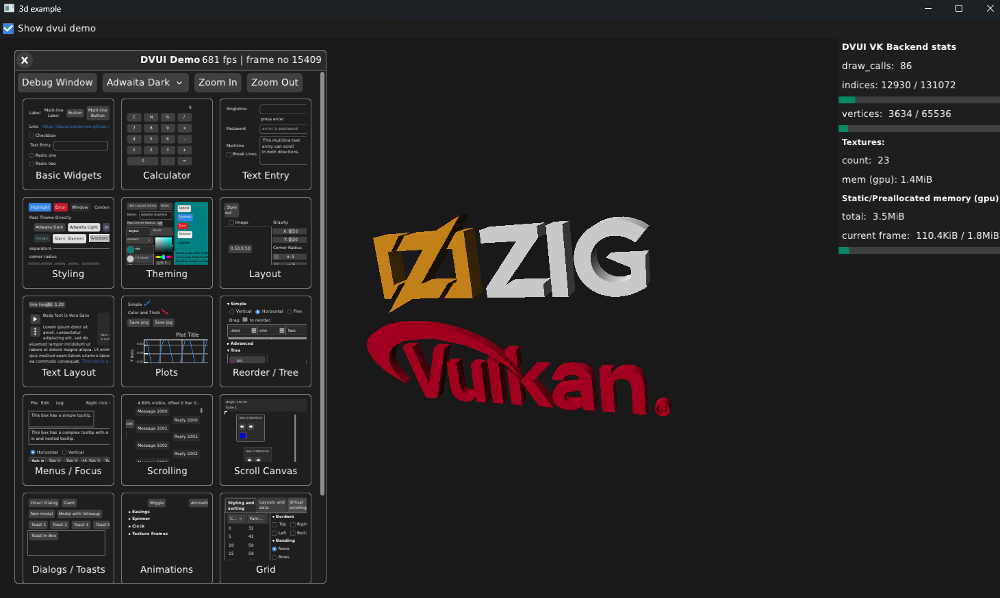

# Vulkan Backend for dvui

> [!NOTE]
> Vulkan renderer and Wio Vulkan backend developed here were merged into DVUI in [david-vanderson/dvui#941](https://github.com/david-vanderson/dvui/pull/941).
> This now is my personal experimentation repository for integrating [DVUI](https://github.com/david-vanderson/dvui) with my custom low-level [`low`](https://github.com/Deins/low) windowing library. 

[](https://github.com/Deins/dvui_vk/actions/workflows/build.yml)

Targets Vulkan 1.3 and newer and Zig 0.16 (see tags for older versions).



### Scope and platform support

- Windows and Linux through `low`; Linux builds support X11 and Wayland.
- The custom DVUI platform backend, Vulkan presentation integration, and experiments specific to `low` remain here.
- The renderer and Wio backend live in DVUI upstream and are intentionally not duplicated here.

The remaining backend is split into:

- [dvui_vk_low.zig](./src/dvui_vk_low.zig) — DVUI platform integration using `low` for cross-platform windowing and input.
- [dvui_vk_common.zig](./src/dvui_vk_common.zig) — Vulkan context, presentation, and rendering glue shared by the `low` integration.

### todo, known issues
- Rendering:
    - Linear color-space framebuffers (easy to switch in source, but tricky to expose cleanly).
- Platform functionality:
    - Try FreeType for DVUI text rendering instead of the default stb-truetype.
    - Touch events.
    - Some platform-specific functionality is still incomplete; see [TODO.md](./TODO.md).

## Build & Run
```sh
zig build run-app -Doptimize=ReleaseFast
```
Vulkan SDK is optional but recommended for development (to be able to run vulkan validation layers etc). To use vulkan sdk make sure `VULKAN_SDK` environment variable is correctly defined. 

Shaders when modified need be recompiled by adding `-Dslangc` to build command. ([slangc](https://github.com/shader-slang/slang/releases) comes packaged with vulkan SDK or needs to be installed separately).

### Standalone with Vulkan 3D rendering
`zig build run --build-file ./examples/3d/build.zig`
Or alternatively `cd examples/3d` and `zig build run`

### Standalone example
Similarly as others, use `run` instead of `run-app`.

### Cross compilation

Build portable binaries by specifying the target explicitly:

```sh
# Windows (GNU ABI)
zig build -Dtarget=x86_64-windows-gnu

# Linux with glibc 2.17 as the minimum supported runtime version
zig build -Dtarget=x86_64-linux-gnu.2.17
```

The Linux version suffix controls the minimum glibc version required on the
target system. Adjust it to match the oldest Linux distribution you support.
